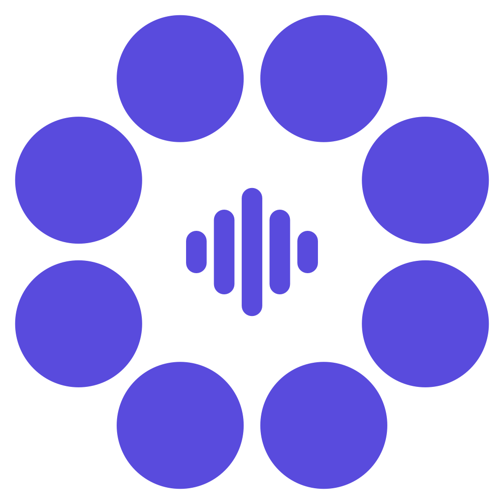
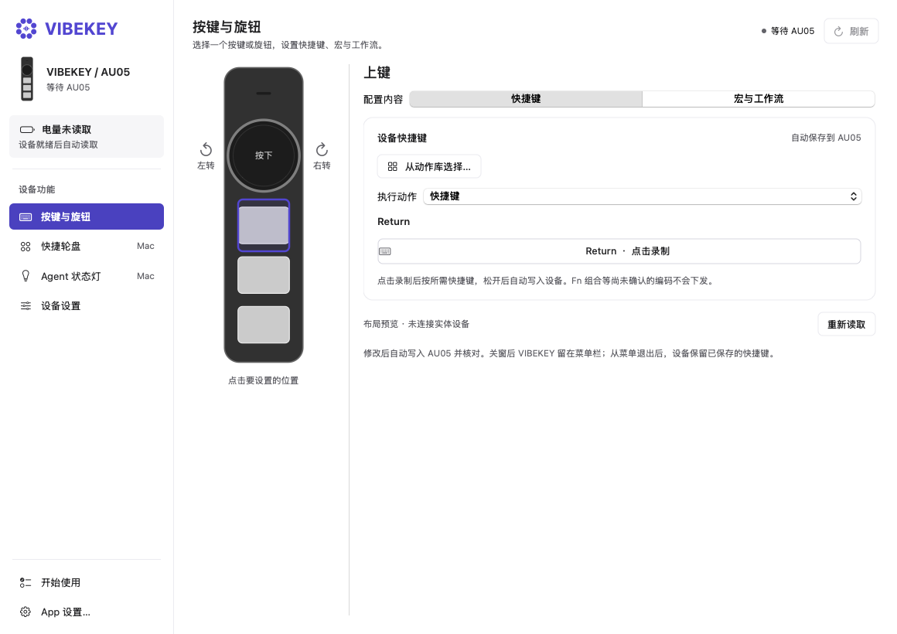
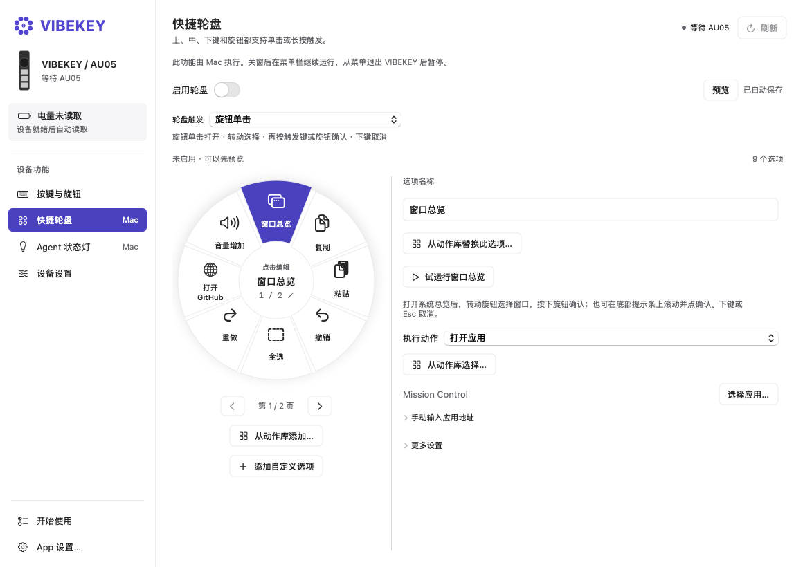
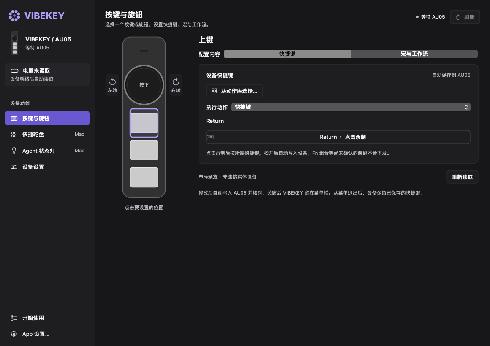

<p align="center"></p>

# VIBEKEY

**A native macOS control center for the AU05: physical shortcuts, rotary control, app workflows, and a paginated radial menu.**

[简体中文](README.zh-CN.md) · **English** · [Getting started](docs/GETTING_STARTED.md) · [Architecture](docs/ARCHITECTURE.md) · [Contributing](CONTRIBUTING.md)


VIBEKEY turns the AU05's three keys and rotary knob into a small, configurable workspace for everyday Mac tasks. Map a key to a shortcut, build a sequence of actions, switch behavior for a particular app, or open a radial menu and rotate through your tools without returning to the settings window.

The app is written in **SwiftUI and AppKit**, with direct IOKit HID communication and local configuration storage. Core features need no online account, subscription, API key, or cloud backend.

This repository contains the **AU05-only, open-source hardware controller**, based on version **0.15.3**. The interface is currently in Simplified Chinese; both English and Chinese documentation are provided. Speech recognition, dictation, language models and an input-method engine are outside this version's scope.

## See the app



*Native app rendering with isolated example settings. Device artwork is an original schematic. Screenshots show the interface, not a physical-device or cross-app execution test.*

<details>
<summary>Radial menu and dark appearance</summary>





</details>

## What you can do

| Capability | What it does |
| --- | --- |
| Six physical controls | Configure the upper, middle and lower keys, knob press, and left/right rotation from a visual device map. |
| Device shortcuts | Read and edit the AU05's supported shortcut fields, with validation, private backups, write/readback checks and recovery handling. |
| Mac workflows | Chain keyboard shortcuts, app launches, web pages, macOS Shortcuts, input-source selection, waits, scrolling and volume controls. |
| App-specific bindings | Use a different saved workflow when a selected application is in the foreground. |
| Radial menu | Keep up to 64 entries in pages of eight. Rotate or scroll across page boundaries in either direction, then confirm the selected action. |
| Flexible activation | Choose a supported key or knob trigger, including press/hold modes. A hold trigger keeps its short-press behavior. |
| Action library | Search reusable actions for everyday applications and add them to workflows or the radial menu. |
| Window overview | Invoke macOS window overview and navigate it through the configured rotary workflow. System settings and accessibility affect behavior. |
| Lighting | Read supported firmware light modes and brightness; optionally follow fresh Agent state with bounded writes and restoration. |
| Battery | Show charge percentage, charging status and sample freshness. Poll about every 30 seconds while the connection is ready and idle. |
| Menu-bar operation | Close the main window and keep Mac workflows running. Use the menu's Quit command for the normal save/restore shutdown path. |
| Appearance | Follow the system appearance or select light/dark mode, using the app's violet visual system. |

### Practical examples

- **Writing and research:** put copy, paste, a writing app, a browser page, and a macOS Shortcut on physical keys or the radial menu.
- **Reading:** bind the knob to vertical scrolling and choose the software scroll amount, from 1 to 50 lines per step.
- **A repeatable sequence:** launch an app, wait briefly, then send the shortcut that starts your usual task.
- **Different tools in different apps:** keep a global binding and override it for a specific foreground application's bundle identifier.
- **Coding sessions:** opt in to Agent status lighting so supported running, approval, and turn-end events can be represented on the device.

Actions run with your Mac user's permissions and act on the current application. Check the target application's own shortcuts before enabling an example. A preset describes a mapping; it does not prove that every version or keyboard layout will interpret it identically.

## Device settings and Mac behavior

VIBEKEY keeps the device's own shortcut layer separate from computer-side automation:

| Layer | Stored where | Does VIBEKEY need to stay open? |
| --- | --- | --- |
| Supported on-device shortcut fields | AU05, after a confirmed write | Needed to configure; behavior after quitting depends on the device firmware and connection. Verify it on your hardware. |
| Multi-step and per-app workflows | This Mac | Yes |
| Radial menu and software scroll amount | This Mac | Yes |
| Agent state lighting and battery monitoring | Local state plus supported device fields | Yes |

Opening an editor or previewing a radial menu does not execute its actions. Valid workflow and menu changes save locally; enabling a feature is a separate choice. Invalid edits retain the last valid saved configuration. Normal shutdown waits for pending configuration work and attempts to restore borrowed lighting settings.

## Build from source

Requirements:

- An **Apple silicon Mac**, running **macOS 13.3 or later**.
- Apple's **Command Line Tools for Xcode**, with **Swift 5.8 or later** and the macOS SDK.
- **Python 3.11+** for the full test suite and optional Agent bridge. The App build itself uses the system Swift tools.
- Compatible AU05 hardware to use physical keys, device settings and lighting. You can inspect the UI and run isolated logic checks without it.

```sh
git clone https://github.com/noahnan-max/VIBEKEY-App.git
cd VIBEKEY-App
./script/build_and_run.sh --build-only
open dist/VIBEKEY.app
```

The script builds the core, diagnostic executable and GUI, creates an actual `.app` bundle, and verifies its local development signature. It does not install a driver, download a model, install Agent hooks, or replace an App in `/Applications`.

The default signature is **ad hoc for local development**. This is not an Apple-notarized release or a promise of warning-free installation on another Mac. Rebuilding an ad-hoc-signed application can require renewed Accessibility approval. To use an identity already configured on your own Mac:

```sh
VIBEKEY_SIGNING_IDENTITY="Your existing signing identity" ./script/build_and_run.sh --build-only
```

`Package.swift` is also included for IDE/SwiftPM integration. The documented build uses `swiftc` directly so it also works with supported Command Line Tools installations where SwiftPM's platform discovery is unavailable. Intel, Windows and Linux builds have not been validated.

## First use

1. Connect the AU05 using the supported data connection. Avoid running a second program that owns the same HID device.
2. Open VIBEKEY and check its connection state under **开始使用** (Getting started).
3. Grant **Accessibility** access when you want VIBEKEY to send keyboard events or run Mac workflows.
4. Select a physical key in **按键与旋钮**. Choose the device shortcut editor or **宏与工作流** (Macros and workflows), then configure and enable the behavior you want.
5. Open **快捷轮盘**, choose its trigger, and add actions. Its preview is for selection and layout inspection.
6. Close the window to keep the app in the menu bar; use **退出 VIBEKEY** to quit normally.

See [the bilingual getting-started guide](docs/GETTING_STARTED.md) for troubleshooting and storage locations.

## Optional Agent status lighting

The included bridge understands supported **Codex** and **Claude Code** hook metadata. The App also contains a version-restricted, read-only Codex Desktop compatibility reader. Neither mechanism is required for shortcuts or workflows.

- The bridge stores typed state, timestamps, ordering information and hashed correlation identifiers. It discards prompt text, assistant replies and tool arguments instead of retaining their raw payloads.
- The Desktop compatibility reader reads local session files and extracts allowlisted metadata. It does not write copies of conversations. The normal App starts this local reader automatically when sources are available; turning off lighting does not disable reading. See the integration guide for a build without the reader.
- **Running**, **approval requested**, and **turn ended** are different states. A turn ending is not a claim that a business task succeeded.
- Simulation is display-only and cannot be used as evidence of a physical light change.
- Lighting writes are limited to supported mode/brightness fields, use full readback, and preserve other bytes. Custom RGB, per-zone effects and the bottom charging indicator are not exposed.
- Hook loading, trust review and compatibility depend on the installed Agent version. The bridge prints a merge plan and does not silently install or replace hooks.

Read [Agent integration](docs/AGENT_INTEGRATION.md) before connecting a live Agent.

## Privacy and local data

Configuration lives in `~/Library/Application Support/Vibekey/`; macOS preferences use the App's bundle identifier. Workflows may contain your URLs, app choices and shortcut names, so treat that directory as personal data.

This source distribution contains no user configuration, conversation history, recordings, API credentials, signing keys, private hardware backups, retired speech components or manufacturer application packages. There is no bundled analytics SDK or required online service. A workflow can open a web page or call software you selected; those actions have their own network behavior.

Do not include raw device backups, Agent transcripts, or the whole configuration folder in a public bug report. See [SECURITY.md](SECURITY.md).

## Development and verification

```sh
./script/run_tests.sh
```

This runs the existing isolated hardware/core suites, battery checks, Codex metadata fixtures and Python Agent bridge tests. Tests use in-memory or owned example data; the runner does not write to physical hardware, post system input or install hooks. Additional XCTest cases are available through `swift test` on a full compatible Xcode/SwiftPM toolchain.

The initial publication's exact checks and remaining gaps are recorded in [Verification](docs/VERIFICATION.md). A successful build or mock-transport test does not certify every firmware, connection, application shortcut or physical lighting effect. Hardware testing, broader application compatibility, genuine approval-state lighting and low-battery physical triggering require separate acceptance.

## Project layout

```text
Sources/Vibekey/         SwiftUI/AppKit application, stores and controllers
Sources/VibekeyCore/     AU05 transport, protocol, workflow and state logic
Sources/VibekeyProbe/    Explicit diagnostic command-line entry point
Tests/                  SwiftPM/XCTest validation cases
tools/                  Isolated behavioral checks and synthetic fixtures
script/                 Portable build/test scripts and optional Agent bridge
Assets/Brand/           App identity assets
docs/                   Bilingual guides, architecture and verification
```

[Architecture](docs/ARCHITECTURE.md) explains control ownership, event routing, persistence and the shutdown path.

## Contributing and license

Bug reports, documentation improvements, accessibility refinements and reproducible compatibility evidence are welcome. Start with [CONTRIBUTING.md](CONTRIBUTING.md); include the app revision, macOS version and connection type, and remove personal data.

Original project code and documentation are available under the [MIT License](LICENSE). Platform and hardware names identify compatibility and do not imply manufacturer endorsement. See [third-party notices](THIRD_PARTY_NOTICES.md).
