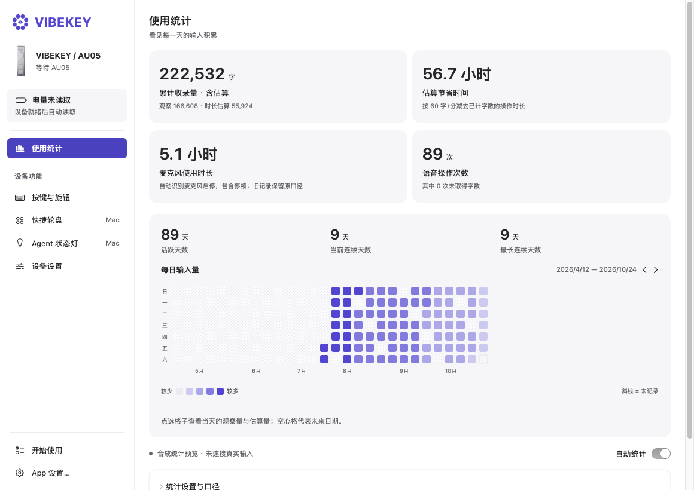
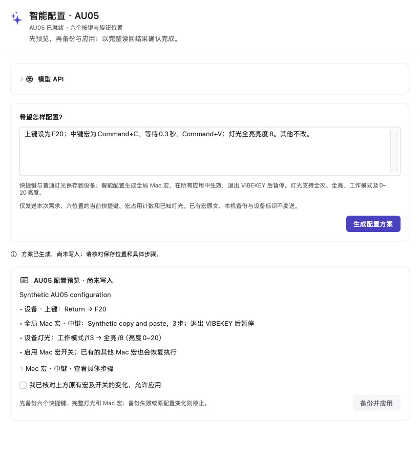

<p align="center"></p>

# VIBEKEY

**把 AU05 的三颗按键和旋钮，变成 Mac 上顺手的快捷键、宏与轮盘工具。**

**简体中文** · [English](README.md) · [开始使用](docs/GETTING_STARTED.md) · [架构说明](docs/ARCHITECTURE.md) · [参与贡献](CONTRIBUTING.md)


VIBEKEY 是一款原生 macOS 硬件控制 App。它把 AU05 的上、中、下三颗按键、旋钮按下和左右旋转六个操作位置，连接到日常使用的应用、快捷键和工作流程：按一下打开工具，转动旋钮阅读长文，或者呼出轮盘，在常用动作之间快速选择。

应用使用 **SwiftUI + AppKit** 开发，通过 **IOKit HID** 与设备通信，配置保存在本机。基础功能不需要注册账户、订阅服务、API Key 或云端后台。

本仓库为 **AU05 专用开源版**，当前源码版本 **0.21.1**，新增可自主开启的使用统计和先预览后应用的智能配置，并保留日常预设、硬件控制及既有签名更新通道。[正式下载与更新说明](https://github.com/noahnan-max/VIBEKEY-App/releases)见 Releases；分发包另行完成 Developer ID 签名、Apple 公证与票据装订。App 使用简体中文界面，配有中英文文档。

App 不内置自研语音识别或输入法引擎。统计在主动开启后，本机观察现有输入流程；智能配置可选使用用户自己的兼容模型服务或已安装的 Codex CLI 登录，不提供模型账户或密钥。

## 界面预览


*以上为原生界面和隔离示例配置，设备图由本项目三维模型完整渲染。截图展示界面，不代表本轮完成了实体按键或跨应用执行测试。*

<details>
<summary>查看快捷轮盘和深色外观</summary>


</details>

## 核心功能

| 功能 | 具体能力 |
| --- | --- |
| 使用统计首页 | 实时累计收录量、观察与估算来源、每日热力图和连续天数。主动开启后在本机统计，不录音、不上传统计。 |
| AU05 智能配置 | 自然语言生成快捷键、有界 Mac 宏及普通灯光方案。先审核，确认后才完整备份、写入、读回，并保留恢复入口；模型由用户自行接入。 |
| 六个操作位置 | 在完整 3D 设备图上选择上键、中键、下键、旋钮按下、左转、右转，直接进入对应编辑区域。 |
| 设备快捷键 | 读取并编辑已支持的 AU05 快捷键字段；执行参数校验、私人备份、写入读回及恢复处理。 |
| Mac 宏与工作流 | 组合快捷键、打开应用、打开网页、运行 macOS 快捷指令、切换已启用输入法、等待、滚动、音量与静音等动作。 |
| 按应用配置 | 根据前台应用切换工作流，保留通用配置，也可针对某个应用设置专用动作。 |
| 快捷轮盘 | 每页 8 项，最多 64 项；转动或滚动逐项选择，跨越边界自动翻页，反向操作可返回上一页。 |
| 自定义入口 | 选择受支持的按键或旋钮单击、长按入口；长按入口保留原有短按行为。 |
| 可搜索动作库 | 从常见应用和系统操作中检索动作，添加到宏或轮盘。 |
| 窗口总览 | 通过配置的旋钮工作流调用并导航 macOS 窗口总览；实际行为受系统设置和辅助功能权限影响。 |
| 灯光与 Agent 联动 | 调整已支持的模式和亮度，可选跟随新鲜的 Agent 状态；写入受限、完整读回并尝试恢复原值。 |
| 电量状态 | 显示百分比、充电状态和数据新鲜度；设备连接就绪且空闲时约每 30 秒读取一次。 |
| 菜单栏运行 | 关闭窗口后继续运行电脑端功能，正常退出前处理配置保存及借用灯光的恢复。 |
| 登录启动 | 在 App 设置中开关登录时启动；自动启动只驻留菜单栏。 |
| 签名更新 | 后台静默检查，红点提示、App 内更新说明，用户主动确认后才下载替换。 |
| 首次使用预设 | 六个操作位及 12 项轮盘承接项目保存的日常配置，首次打开即可查看和使用，已有配置继续保留。 |
| 明暗外观 | 跟随系统，或选择浅色、深色外观，沿用项目的紫色视觉体系。 |

### 适合哪些工作场景

- **写作与资料整理**：把复制、粘贴、打开写作工具、常用网页和快捷指令放到按键或轮盘里。
- **长文阅读**：旋钮控制上下滚动，电脑端每格滚动量可设为 1–50 行。
- **重复操作**：先打开应用，等待一小段时间，再发送常用快捷键，把固定步骤组合成宏。
- **同一硬件、多种应用**：给全局动作保留默认映射，进入指定前台应用后使用另一套配置。
- **编程工作**：按需连接 Agent 状态，在设备上提示受支持的运行、审批和本轮结束事件。

动作会以当前 Mac 用户的权限运行，并作用于当前应用。启用预设前，请核对目标软件自己的快捷键。动作库提供映射定义，不代表每个软件版本、键盘布局和系统设置都已经逐项验证。

日常预设包含左 Control、Return、Backspace、旋钮单击轮盘和滚动（向上 19 行、向下 18 行，均可调整），轮盘分两页提供编辑、窗口、全屏、静音与截图动作。完整映射见[内置预设说明](docs/PRESETS.md)。首次使用仍需连接设备，并为电脑端操作允许辅助功能；加载预设本身不会写入设备固件或执行宏。

## 使用统计与智能配置

统计首页按文字出现时累计收录量，后续删减不扣回，并区分观察字数与按麦克风时长估算的字数。关闭统计保留历史。无法读取的输入框、静音、极快发送及同框手工编辑会影响覆盖，不将它宣传为所有输入法的精确逐字统计或实测生产率提升。详见[统计口径、用途选择与存储](docs/USAGE_STATISTICS.md)。

智能配置从 AU05 页或设备菜单打开，支持用户自配兼容 API 或可选的本机 Codex CLI 登录。模型只接收本次需求和允许的 AU05 状态；先生成差异预览，用户确认后才开始完整备份与写入读回。设置保存、模型调用成功和设备应用成功分别显示，超出能力的需求会停止或澄清。详见[模型接入、支持范围与恢复](docs/SMART_CONFIGURATION.md)。

旋钮单步滚动行数现在放在「快捷键」中；多步骤宏继续保留每步的滚动量。已有按键映射、轮盘和预设继续保留。





*以上为隔离原生界面、合成历史与回环模型方案，展示页面和预览流程，不是私人使用记录、真实模型账户或实体按键执行证据。*

## 设备配置和电脑端功能如何区分

| 配置层 | 保存位置 | 是否需要 App 持续运行 |
| --- | --- | --- |
| 已支持的设备快捷键 | 完成写入并读回后保存在 AU05 | 配置时需要；退出后的行为取决于设备固件和连接方式，请在自己的硬件上核验。 |
| 多步骤宏、按应用工作流 | 当前 Mac | 需要 |
| 快捷轮盘、软件滚动幅度 | 当前 Mac | 需要 |
| Agent 状态灯、电量监测 | 本机状态与已支持的设备字段 | 需要 |

打开编辑器不会执行动作，轮盘预览也不执行动作。有效的宏和轮盘编辑会自动保存，功能启用由独立开关控制；无效草稿保留最后有效的配置。正常退出时，App 会等待待处理配置，并尝试恢复借用前的灯光。

## 从源码构建

准备条件：

- **Apple silicon Mac**，运行 **macOS 13.3 或更高版本**。
- 安装 Apple 的 **Xcode Command Line Tools**，包含 **Swift 5.8+** 与 macOS SDK。
- 完整测试和可选 Agent 桥接需要 **Python 3.11+**；App 本体构建使用系统 Swift 工具。
- 实体按键、设备设置和灯光需要兼容的 AU05。没有设备也可以检查界面和运行隔离逻辑测试。

```sh
git clone https://github.com/noahnan-max/VIBEKEY-App.git
cd VIBEKEY-App
./script/build_and_run.sh --build-only
open dist/VIBEKEY.app
```

首次构建会下载官方固定版本 Sparkle 2.10.0 并核对 SHA-256。构建脚本会编译核心、诊断工具及 GUI，生成完整 `.app` 并检查本地开发签名。它不会安装驱动、下载模型、安装 Agent hooks，也不会替换 `/Applications` 中的在用 App。

构建脚本默认采用 **ad hoc 本地开发签名**，输出不会自动进行 Apple 公证。正式 0.16.1 下载包已单独完成 Developer ID 签名、公证与票据装订；自行重新构建后，辅助功能权限仍可能需要重新授予。如果你已有自己的签名身份，可以显式指定：

```sh
VIBEKEY_SIGNING_IDENTITY="你已配置的签名身份" ./script/build_and_run.sh --build-only
```

项目同时包含 `Package.swift`，便于 IDE 和 SwiftPM 使用。文档中的构建入口直接调用 `swiftc`，兼容部分无法通过 SwiftPM 识别完整平台路径的 Command Line Tools 环境。Intel、Windows、Linux 构建尚未验证。

## 第一次使用

1. 使用受支持的数据连接方式接入 AU05，避免另一个程序同时占用同一 HID 设备。
2. 打开 App，在「开始使用」中查看连接状态。
3. 需要发送键盘事件、执行 Mac 工作流时，在系统设置中授予「辅助功能」权限。
4. 在「按键与旋钮」选择实体位置，切换「快捷键」或「宏与工作流」编辑器，配置后再启用需要的行为。
5. 在「快捷轮盘」选择入口并添加动作，先用预览检查布局。
6. 关闭主窗口后可从菜单栏再次打开；通过「退出 VIBEKEY」正常结束运行。

连接排查、数据位置与使用注意事项见[中英文上手指南](docs/GETTING_STARTED.md)。

## 可选的 Agent 状态灯

仓库包含面向受支持 **Codex / Claude Code** hook 事件的桥接脚本，以及受版本限制的 **Codex Desktop** 本地只读兼容读取。快捷键、宏和轮盘不依赖这些接入。

- 桥接器保留状态、时间、顺序和哈希关联标识，丢弃提示词、助手回复及工具参数，不保存原始事件内容。
- Desktop 兼容读取会访问本机 session 文件并提取白名单元数据，不复制会话正文。正常 App 会自动启动可用的本地状态读取，关闭灯光不等于关闭读取；不含读取行为的构建方式见集成说明。
- 「运行中」「请求审批」「本轮结束」是不同状态；本轮结束不代表整个业务任务完成。
- 软件模拟只用于界面展示，不能充当真实灯光已变化的证据。
- 只控制已确认的模式与亮度，完整读回并保留其他字段；不提供自定义 RGB、独立灯区或底部充电灯控制。
- hook 的加载、信任审阅和兼容性取决于已安装的 Agent 版本。脚本只生成合并方案，不自动安装、不覆盖原 hooks。

正式接入前请阅读 [Agent 集成说明](docs/AGENT_INTEGRATION.md)。

## 开机登录启动与软件更新

App 设置中提供「登录时启动 VIBEKEY」开关，由 macOS 原生登录项管理。自动启动只留在菜单栏；主动打开 App 或点击菜单入口时才显示主窗口。

「自动检查更新」约每天查询一次，可以关闭。后台发现新版不弹窗、不抢焦点，菜单栏图标与 App 设置入口显示未读标记；手动检查的结果也显示在设置中。可先展开「查看更新内容」，再选择「更新并重新启动…」，经过主动确认后才下载、校验和替换 App。更新包与版本信息均使用 Ed25519 签名，不允许静默下载安装，也不发送系统画像。

从 0.15.3 首次升级需要手动安装一次 0.16.0，因为旧版本尚无检查器；后续可使用 App 内更新。维护流程见[更新发布说明](docs/UPDATES.md)。

## 隐私与数据

配置保存在 `~/Library/Application Support/Vibekey/`，系统偏好随 App 的 bundle identifier 保存。工作流可能包含私人网址、应用选择和快捷指令名称，请把该目录当作个人数据保护。

公开源码不包含个人配置、对话记录、录音、API 凭据、签名私钥、设备完整备份、退役语音组件或原厂 App 安装包。硬件控制没有内置分析 SDK，也不要求在线服务。可选统计只保留本机汇总，原文仅在有界内存中短暂使用，不上传统计。可选模型请求只向用户所选服务发送本次描述与允许的 AU05 状态，密钥使用公开 App 自己的端点隔离钥匙串条目；不会导入私人研发配置或凭证。你配置的网页、快捷指令或其他软件可能有它们自己的联网行为。

公开报错时，不要附上整份用户配置、设备备份或 Agent transcript，详见 [SECURITY.md](SECURITY.md)。

## 开发与验证

```sh
./script/run_tests.sh
```

该入口运行硬件核心、工作流、轮盘、灯光、统计与用途选择/历史保留、AU05 智能配置事务、密钥缓存、旧公开配置保留、登录启动、电量、Codex 元数据和 Python 桥接检查，使用内存模拟或隔离示例数据，不写实体设备、不发送系统输入、不安装 hooks。完整兼容的 Xcode / SwiftPM 环境还可以用 `swift test` 运行附带的 XCTest 用例。

初次开源的实际验证和缺口见[验证记录](docs/VERIFICATION.md)。构建或模拟传输测试通过，不等于所有固件、连接方式、目标应用和真实灯效均已验收；实体硬件、更多办公软件、真实审批提示和低电量实物触发需要分别验证。

## 目录结构

```text
Sources/Vibekey/         SwiftUI / AppKit 界面、Store 与控制器
Sources/VibekeyCore/     AU05 通信协议、工作流和状态逻辑
Sources/VibekeyProbe/    显式运行的诊断命令行入口
Tests/                  SwiftPM / XCTest 校验
tools/                  隔离行为检查与合成测试数据
script/                 构建、测试、可选 Agent 桥接
Assets/Brand/           项目标识资源
docs/                   中英文指南、架构和验证记录
```

协议所有权、事件路由、持久化及退出流程详见[架构说明](docs/ARCHITECTURE.md)。

## 贡献与开源协议

欢迎提交可复现的问题、文档改进、辅助功能优化和设备兼容证据。提交前请阅读 [CONTRIBUTING.md](CONTRIBUTING.md)，说明版本、macOS 和连接方式，并去掉个人数据。

项目原创代码与文档采用 [MIT License](LICENSE)。平台、软件和硬件名称用于说明兼容对象，不表示厂商背书；第三方说明见 [THIRD_PARTY_NOTICES.md](THIRD_PARTY_NOTICES.md)。
