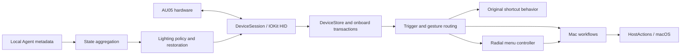

# Architecture / 架构说明

VIBEKEY is a native desktop application with one AU05 transport owner. The open-source App has no embedded web server, web frontend, speech subsystem, or hosted model backend. Optional user-configured model clients plan AU05 changes; consent-gated usage observation is a separate local side channel.

## Responsibilities

| Area | Main sources | Responsibility |
| --- | --- | --- |
| Protocol and transport | `Sources/VibekeyCore/HIDTransport.swift`, `DeviceProtocol.swift`, `AU05Codec.swift` | Device discovery, connection, framing, replies and serialized device requests |
| On-device shortcuts | `AU05OnboardShortcut.swift`, `AU05ShortcutTransaction.swift`, `Stores/AU05OnboardStore.swift` | Supported-value validation, pre-write backup, write/readback and recovery state |
| Routing | `HardwareBindingRouter.swift`, `RadialGestureRouter.swift`, `Stores/AU05OriginalActions.swift` | Stable press/release ownership, original behavior, custom bindings and radial activation |
| Host automation | `HostActions.swift`, `WorkflowModels.swift`, `Stores/WorkflowStore.swift` | Validated action data, explicit execution, cancellation and per-app bindings |
| Radial menu | `RadialMenu.swift`, `RadialScrollInput.swift`, `Stores/RadialMenuController.swift` | Selection, paging, overlay, gesture handling and confirmation |
| Window overview | `WindowOverviewNavigation.swift`, `Stores/WindowOverviewController.swift` | System overview navigation and ownership/cancellation |
| Persistence | `ConfigurationAutosaver.swift`, `WorkflowPersistence.swift`, `Stores/RadialMenuStore.swift` | Local atomic saves and last-valid configuration |
| Agent state | `AgentSignal.swift`, `CodexDesktopStatus.swift`, `Stores/AgentSignalStore.swift` | Freshness, typed state, ordering, correlation and simulation separation |
| Lighting | `SmartLightingPolicy.swift`, `Stores/SmartLightingController.swift` | Supported fields, bounded writes, revocable permits and restoration |
| Battery | `BatteryStatus.swift`, `Stores/BatteryNotificationController.swift` | Fresh/stale samples, thresholds, deduplication and permission-aware notifications |
| Lifecycle | `App/VibekeyApp.swift`, `Support/RuntimeOwnership.swift` | One cooperating runtime owner, menu-bar behavior, flush and normal shutdown |

Paths without the `Sources/` prefix in this table are relative to the corresponding core or application directory.

## Boundaries that matter

1. **One device owner:** views do not create their own HID sessions. Device work flows through the runtime's `DeviceStore` and serialized transport.
2. **Configuration versus execution:** selecting a hardware control opens its editor. Editing and previewing do not run a workflow. Invalid draft data does not become active saved configuration.
3. **Held input ownership:** a press and its release retain their routing owner. Disconnect, cancellation and shutdown release held state instead of leaving a modifier pressed.
4. **Local persistence:** host workflows and radial settings are Mac configuration. The device's supported onboard fields are a distinct transaction domain.
5. **Recovery:** supported device writes require readback. The App preserves recovery information and can delay shutdown when restoration is unconfirmed.
6. **Agent semantics:** a proposal to stop, an approval request and a real turn closure are different events. Simulation is never physical evidence. Stale or unsupported sources remain unknown.

The diagnostic executable is a separate explicit entry point. Its hardware access is not invoked by the normal automated test runner.

## Usage and model boundaries

`PassiveInputStatistics` models local aggregate history; `AutomaticMicrophoneMonitor`, `PassiveInputObserver` and `UsageStatisticsStore` run the optional read-only side channel. Versioned consent gates every observation entry. The original input path executes first and never awaits AX reads or disk writes. Provisional counts are merged once; pause/shutdown preserve received totals.

`SmartConfigurationAPI` and `SmartPlanDecoding` are generic transport/schema utilities in VibekeyCore. The AU05-only model Store uses a public preferences directory and Keychain namespace. `AU05SmartPlanner` validates the proposal, and `AU05SmartTransaction` reserves existing device ownership, compares the baseline, persists a complete backup, performs bounded writes and verifies readback/rollback. The model cannot call host actions directly. Statistics do not enter its context.

The existing public bundle identity, signed updater and launch-at-login behavior remain in place. Update preparation and shutdown flush statistics and respect pending AU05 recovery before replacement.

## 中文说明

App 由 SwiftUI / AppKit 界面、AU05 协议核心和单一设备会话构成。界面通过 Store 读取状态并提出操作，不自行建立第二条 HID 通道。按键事件先经过归属和手势路由，再进入原快捷键行为、工作流或轮盘控制器。

设备快捷键与电脑工作流分别管理。前者通过设备事务、备份和完整读回来确认；后者保存在 Mac，并由有效配置、启用开关和前台应用共同决定执行。按下与松开的路由归属保持一致，取消、断开和退出会处理持有状态。

Agent 事件只形成状态输入，不能生成任意工作流或越过执行边界。灯光借用原设备参数，限定字段并读回；正常退出先保存配置、停止电脑端动作、尝试恢复灯光及设备状态。失败时保留错误和恢复入口，不把进程结束当成恢复成功。

公开源码没有内置 Web 服务、语音引擎、输入法引擎或托管模型后台；可选模型客户端由用户自行接入，统计是经主动选择的独立本机旁路，不进入语音或模型数据流。诊断命令行工具是单独入口，不属于默认自动化测试的真实硬件路径。
